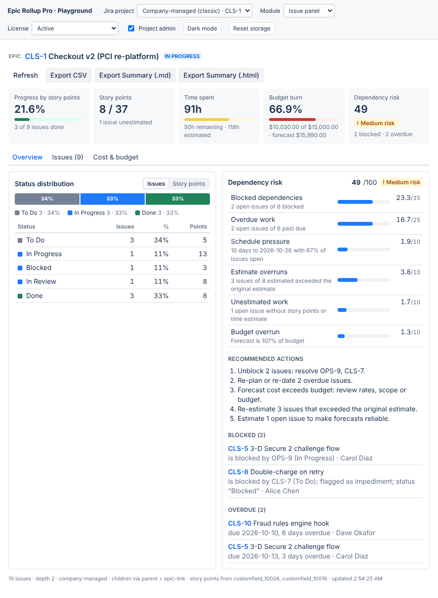
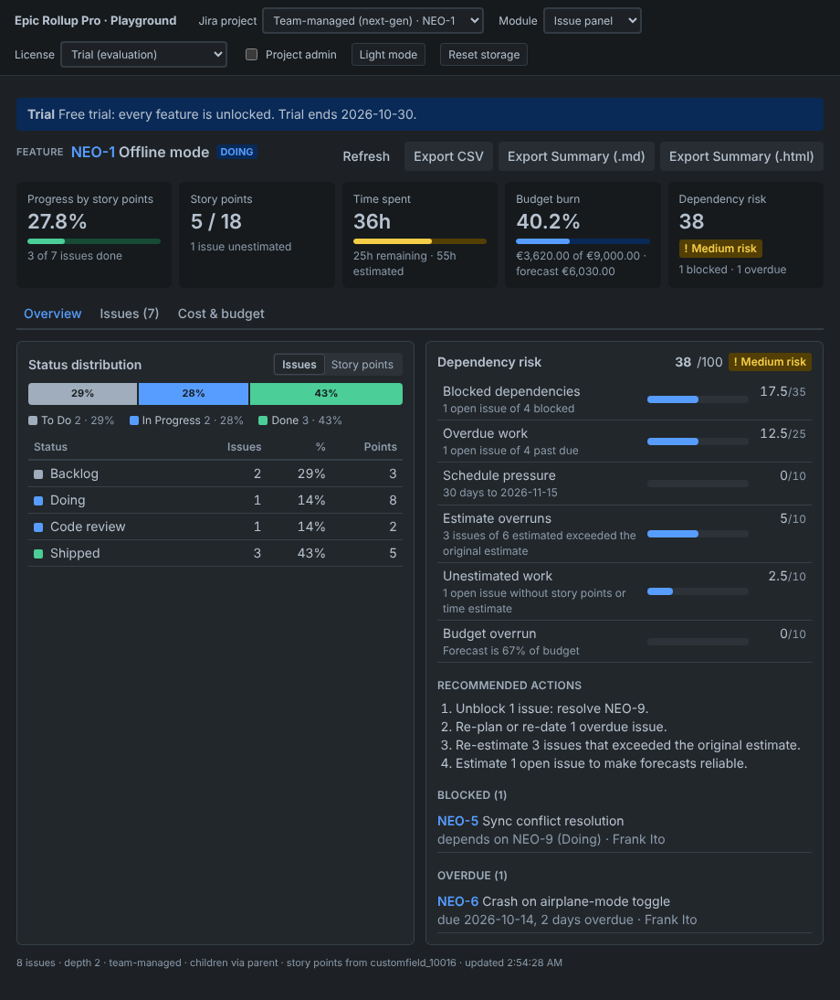
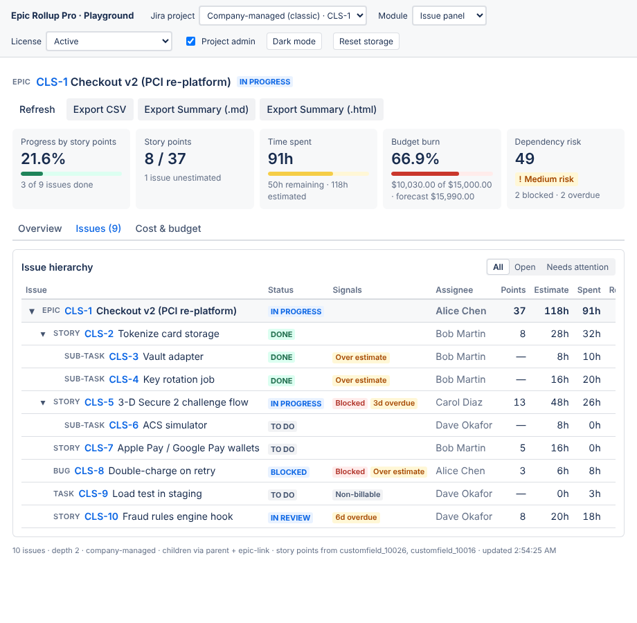
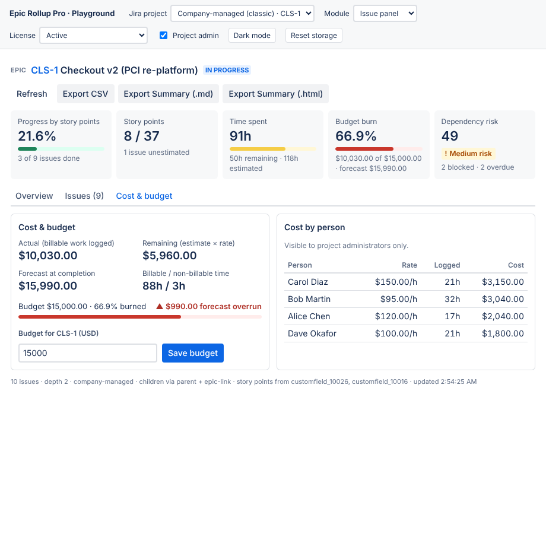

# Epic Rollup Pro for Jira Cloud

Epic → child issue → subtask rollups for **both company-managed (classic) and team-managed (next-gen) projects**, with billable cost and budget burn, a dependency risk score, and one-click CSV / executive summary export. Built on Atlassian Forge with **zero egress** so it qualifies for the *Runs on Atlassian* badge.

| What it rolls up | How |
| --- | --- |
| Original estimate, time spent, remaining estimate | Per-issue values summed once per level (never Jira's `aggregate*` fields, so nothing is double counted). Done work has 0 remaining; open work without a remaining estimate falls back to `original − spent`, like Jira. |
| Story points | Auto-detects the classic **Story Points** field and the next-gen **Story point estimate** field (first populated wins); per-project override. Counted on standard-level issues; never on the epic itself; optionally on subtasks. |
| Status distribution % | By status category (To Do / In Progress / Done) and by workflow status, by issue count or story points. Percentages always sum to 100 (largest-remainder). |
| Billable cost & budget burn | Hourly rates (default + per person) in Forge KVS. Actual cost is attributed to each **worklog author's** rate (all worklog pages are fetched); remaining cost = remaining estimate × assignee rate; forecast = actual + remaining. Non-billable labels, per-epic budget, burn %, forecast variance. |
| Dependency risk score (0–100) | Blocked (open `is blocked by` / `depends on` links, Flagged, *Blocked*/*On hold* statuses) 35 · Overdue 25 · Schedule pressure 10 · Estimate overruns 10 · Unestimated work 10 · Budget overrun 10 → LOW / MEDIUM / HIGH / CRITICAL with recommended actions. |
| Exports | CSV (RFC 4180, UTF-8 BOM, formula-injection safe), Executive Summary as Markdown and as self-contained printable HTML. |

| Company-managed epic (issue panel) | Team-managed "Feature" epic (dark mode) |
| --- | --- |
|  |  |
|  |  |

Screenshots come from the `/playground/` preview, which runs the production resolver code against the bundled Jira simulator fixtures.

## Why it works on team-managed projects

Tools that break on next-gen projects usually rely on the legacy *Epic Link* field and on issue type names. This app:

* walks the hierarchy with `parent in (…)` JQL, which Jira Cloud resolves for **both** project types (and for Initiative → Epic → Story → Subtask in Plans hierarchies);
* additionally queries the legacy Epic Link by **field id** (`cf[10014] in (…)`) only on sites that still have it, de-duplicating results, and silently falls back if Jira rejects it;
* identifies levels by `issuetype.hierarchyLevel`, so a team-managed epic renamed to *Feature* still works, and finds project-scoped epic types for the project page by level, not name;
* uses the token-paginated `POST /rest/api/3/search/jql` (the old `/search` endpoint is retired).

## Architecture

```
manifest.yml                 jira:issuePanel + jira:projectPage → Custom UI + resolver; weekly privacy trigger
src/
  index.ts                   handler export (Forge entry point)
  resolvers/index.ts         production wiring: api.asUser().requestJira + @forge/kvs
  resolvers/handlers.ts      6 resolvers, result envelopes, license gating, permission checks
  engine/                    pure, framework-free rollup engine (normalize, rollup, cost, risk)
  jira/                      REST client (route-escaped), field discovery, BFS hierarchy fetch
  services/                  rollup orchestration, settings & budgets (validated)
  export/                    CSV, Markdown and HTML executive summary
  licensing.ts               context.license (isActive | active), trial, sandbox, LICENSE_OVERRIDE
  privacy/                   weekly GDPR personal data report (scheduled trigger), erases closed accounts
  shared/contract.ts         DTOs + resolver keys shared with the UI
static/rollup-ui/            React Custom UI (Vite) + /playground/ preview entry
fixtures/                    Jira Cloud REST simulator + classic / next-gen / large datasets
tests/                       unit, integration (mocked @forge/api + @forge/kvs) and jsdom UI tests
```

**Security model.** Every Jira read runs `asUser()`, so a rollup only ever contains issues the viewer can see. Issue and project keys are validated before they reach JQL or a URL, and URLs are built with Forge's `route` template. Settings and budget writes require *Administer Projects* (or Jira admin) on the project, checked server-side. Personal rates and the per-person cost breakdown are admin-only, and projects can restrict all cost figures to admins. Unexpected errors are logged and returned without internals. Stored Atlassian account ids (personal rates, audit fields) are reported weekly via `privacy.reportPersonalData`, and closed accounts are erased.

## Development

```bash
npm ci
npm run verify            # typecheck, build UI + playground, validate manifest, Forge bundle check, tests
npm test                  # 181 unit / integration / UI tests (Vitest)
npm run test:coverage
npm run playground        # dev server → http://localhost:3000/playground/
npm run playground:preview  # production build of the playground → http://localhost:4173/playground/
```

The **playground** runs the real resolver handlers in the browser against the Jira REST simulator. Switch between company-managed and team-managed projects, issue panel and project page, license states (active, trial, sandbox, inactive), admin and non-admin viewers, and light or dark mode. Query parameters such as `?dataset=nextgen&module=projectPage&license=TRIAL&admin=false` make states linkable.

### Deploying to a Jira Cloud site

```bash
npm install -g @forge/cli && forge login
forge register            # replaces the placeholder app.id in manifest.yml
npm run deploy            # builds the Custom UI, then forge deploy
forge install --site <your-site>.atlassian.net --product jira
forge eligibility         # confirms Runs on Atlassian eligibility
```

Use `forge tunnel` with `npm run dev:ui` (port 3000, matching `resources[].tunnel.port`) for live UI development. In development and staging there is no license object; the app runs in **sandbox** mode with every feature unlocked. `forge variables set LICENSE_OVERRIDE inactive|trial|active` simulates license states outside production.

See [SUBMISSION_GUIDE.md](SUBMISSION_GUIDE.md) for the Marketplace listing and review checklist.
